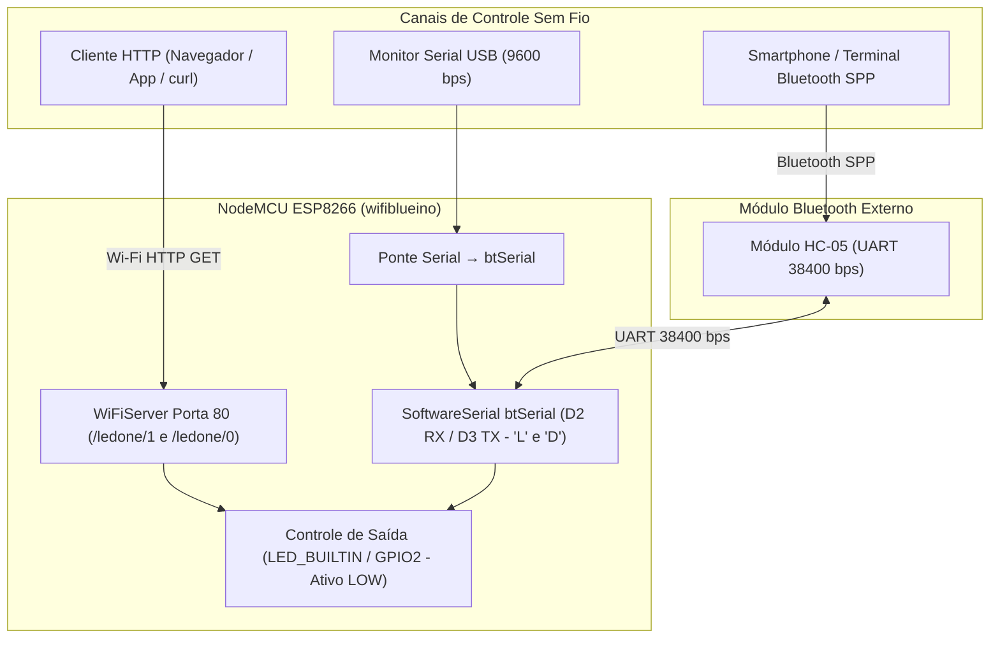
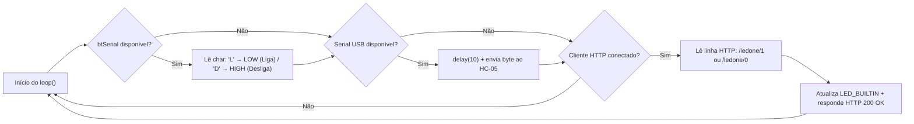

# Controle Dual Wi-Fi e Bluetooth (HC-05) em NodeMCU ESP8266

Firmware embarcado para **NodeMCU ESP8266** que integra dois canais independentes de controle sem fio — **servidor HTTP nativo via Wi-Fi (porta `80`)** e **Bluetooth Classic via módulo HC-05 (`SoftwareSerial` a `38400 bps`)** — para acionamento redundante do LED interno (`LED_BUILTIN`) ou cargas acopladas, incluindo ponte serial para depuração/comandos AT e suporte preparado para IP estático.

[-2B4C7E?style=flat-square)](#comandos-bluetooth-e-endpoints-http)
[-334E68?style=flat-square)](#comandos-bluetooth-e-endpoints-http)
[-1B6B52?style=flat-square)](#hardware-e-mapeamento-de-pinos)

Como o ESP8266 possui conectividade Wi-Fi integrada mas não dispõe de rádio Bluetooth nativo, o projeto combina o barramento TCP/IP interno (`WiFiServer`) com uma porta serial virtual dedicada ao módulo **HC-05**, demonstrando controle concorrente de atuadores por dois meios físicos distintos em um único laço principal.

---

## Sumário

1. [Objetivo](#objetivo)
2. [Justificativa Técnica](#justificativa-técnica)
3. [Cenários de Uso](#cenários-de-uso)
4. [Arquitetura de Controle Dual](#arquitetura-de-controle-dual)
5. [Hardware e Mapeamento de Pinos](#hardware-e-mapeamento-de-pinos)
6. [Comandos Bluetooth e Endpoints HTTP](#comandos-bluetooth-e-endpoints-http)
7. [Configuração Notas Técnicas e Estrutura do Repositório](#configuração-notas-técnicas-e-estrutura-do-repositório)
8. [Contato](#contato)
9. [Stack Técnica e Tecnologias Utilizadas](#stack-técnica-e-tecnologias-utilizadas)

---

## Objetivo

Demonstrar e fornecer uma base funcional em **NodeMCU ESP8266** para controle simultâneo de saídas digitais por **Wi-Fi** e **Bluetooth**, cumprindo os seguintes objetivos:

- Disponibilizar um **servidor HTTP embarcado (`WiFiServer` na porta `80`)** capaz de ligar ou desligar o `LED_BUILTIN` por meio de requisições `GET` simples (`/ledone/1` e `/ledone/0`) com resposta `HTTP/1.1 200 OK`.
- Adicionar conectividade **Bluetooth Classic (SPP)** ao ESP8266 através de um módulo **HC-05** ligado em UART virtual (`SoftwareSerial` em `D2`/`D3` a `38400 bps`), interpretando comandos de caractere único (`L` e `D`).
- Manter uma **ponte serial bidirecional** entre o Monitor Serial USB (`9600 bps`) e o módulo HC-05 para envio direto de dados ou testes de comandos AT.
- Oferecer configuração pré-estruturada de **IP estático** (`WiFi.config(...)`) pronta para ativação em redes locais de automação.

---

## Justificativa Técnica

Dispositivos de automação baseados em ESP8266 frequentemente dependem exclusivamente da disponibilidade da rede Wi-Fi local; quando o roteador cai ou o usuário precisa acionar o equipamento localmente sem estar autenticado na LAN, uma interface de contingência de curto alcance agrega resiliência imediata.

- **Complementaridade Wi-Fi + Bluetooth no ESP8266:** enquanto o Wi-Fi permite integração com sistemas web, aplicativos na rede local e requisições HTTP padronizadas, o módulo **HC-05** provê controle ponto a ponto direto via smartphone/terminal Bluetooth sem exigir infraestrutura de roteador.
- **Preservação da UART física para diagnóstico:** alocar o HC-05 em `SoftwareSerial(D2, D3)` deixa a UART USB (`Serial` a `9600 bps`) livre para monitorar o endereço IP obtido, inspecionar requisições HTTP recebidas e encaminhar caracteres de teste diretamente ao módulo Bluetooth.
- **Servidor HTTP minimalista sem sobrecarga de frameworks:** o uso direto de `WiFiServer` com leitura de cabeçalho via `readStringUntil('\r')` mantém o consumo de RAM e Flash reduzido e facilita a extensão para acionamento de relés, lâmpadas ou fechaduras no lugar do `LED_BUILTIN`.
- **Opção pronta de IP fixo:** incluir o bloco comentado `WiFi.config(...)` simplifica a fixação do endereço IP do módulo na rede local, evitando que clientes HTTP percam a referência após renovações de DHCP.

---

## Cenários de Uso

- **Automação residencial com contingência offline:** acionamento de iluminação, relés ou cargas de bancada por HTTP na rede Wi-Fi e por aplicativo Bluetooth SPP quando a rede local estiver indisponível.
- **Prototipagem e ensino de conectividade híbrida em IoT:** demonstração prática de convivência entre `ESP8266WiFi` (`WiFiServer`) e `SoftwareSerial` (HC-05) em um mesmo firmware.
- **Integração rápida com aplicativos móveis (MIT App Inventor / Flutter / terminais Bluetooth) e automações HTTP (`curl`, Node-RED, Home Assistant):** endpoints diretos e protocolo Bluetooth de 1 byte (`L`/`D`) simplificam a criação de interfaces de controle.

---

## Arquitetura de Controle Dual

### Fluxo do Laço Principal (`loop()`)

---

## Hardware e Mapeamento de Pinos

### Mapeamento Completo — NodeMCU ESP8266 (`wifiblueino`)

| Pino NodeMCU | GPIO ESP8266 | Direção | Conexão / Função |
| :--- | :--- | :--- | :--- |
| `D2` | `GPIO4` | Entrada (`SoftwareSerial RX`) | Conectar ao pino `TXD` do módulo **HC-05** (`38400 bps`) |
| `D3` | `GPIO0` | Saída (`SoftwareSerial TX`) | Conectar ao pino `RXD` do módulo **HC-05** (`38400 bps`) |
| `LED_BUILTIN` (`D4`) | `GPIO2` | Saída Digital | LED interno do ESP8266 (**lógica ativa em `LOW`**: `LOW` = Ligado, `HIGH` = Desligado) |
| `USB (TX0/RX0)` | `GPIO1` / `GPIO3` | UART (`9600 bps`) | Logs de conexão, endereço IP, tráfego recebido e envio ao HC-05 |
| `VIN` (`5 V`) / `GND` | — | Alimentação | Alimentação do módulo HC-05 (com referência `GND` comum ao NodeMCU) |

---

## Comandos Bluetooth e Endpoints HTTP

### 1. Controle via Bluetooth Classic (`HC-05` @ `38400 bps`)

| Caractere Enviado | Nível em `LED_BUILTIN` | Estado Resultante |
| :---: | :---: | :--- |
| `L` | `LOW` | LED **Ligado** |
| `D` | `HIGH` | LED **Desligado** |

### 2. Controle via Wi-Fi (`WiFiServer` na porta `80`)

| Requisição HTTP | Nível em `LED_BUILTIN` | Resposta Retornada (`Content-Type: text/html`) |
| :--- | :---: | :--- |
| `GET http://<IP_DO_ESP>/ledone/1` | `LOW` | `HTTP/1.1 200 OK` → `LED  Ligado` |
| `GET http://<IP_DO_ESP>/ledone/0` | `HIGH` | `HTTP/1.1 200 OK` → `LED  Desligado` |

---

## Configuração Notas Técnicas e Estrutura do Repositório

### Dependências (Arduino IDE / PlatformIO)

- Core **ESP8266 for Arduino** (`ESP8266WiFi.h` e `EspSoftwareSerial` / `SoftwareSerial.h`).

### Passos de Configuração

1. Salve o arquivo [wifiblueino](./wifiblueino) localmente com extensão `.ino` (`wifiblueino.ino`) dentro de uma pasta `wifiblueino` para abrir na Arduino IDE.
2. Preencha `ssid` e `password` da sua rede Wi-Fi (e, opcionalmente, descomente o bloco `WiFi.config(...)` nas linhas `13–17` e `28–30` para usar IP estático).
3. Interligue `HC-05 TXD → NodeMCU D2`, `HC-05 RXD → NodeMCU D3` e `GND` comum, grave o firmware e consulte o IP atribuído no Monitor Serial em `9600 bps`.

> [!WARNING]
> **Pino de *strapping* `D3` (`GPIO0`) no ESP8266:** o pino `GPIO0` determina o modo de inicialização do ESP8266 (nível baixo no reset coloca o chip em modo de gravação). Se o circuito de entrada `RXD` do módulo HC-05 mantiver `D3` em nível baixo durante a energização, o NodeMCU pode não inicializar o sketch — nesse caso, recomenda-se remanejar `SoftwareSerial` para pinos livres sem função de boot, como `D5` (`GPIO14`) e `D6` (`GPIO12`).

> [!NOTE]
> **Notas técnicas para uso em campo:**
> 1. **Baud rate do HC-05 (`38400 bps`):** a velocidade configurada em `btSerial.begin(38400)` coincide com o modo AT do HC-05 (ou com módulos previamente configurados via `AT+UART=38400,0,0`). Em módulos HC-05 com configuração de fábrica no modo de dados (`9600 bps`), ajuste `btSerial.begin(9600)` ou redefina a taxa do módulo.
> 2. **Inicialização da variável `val` no servidor HTTP:** na linha `89`, `int val;` é declarada sem valor inicial; caso um navegador dispare uma requisição automática a `/favicon.ico` (que não casa com `/ledone/1` nem `/ledone/0`), inicializar `val` com o estado atual do LED (ou ignorar rotas desconhecidas) evita respostas inconsistentes.

### Estrutura de Arquivos

| Arquivo | Descrição |
| :--- | :--- |
| [wifiblueino](./wifiblueino) | Firmware completo para NodeMCU ESP8266 com servidor HTTP Wi-Fi (porta `80`), recepção Bluetooth HC-05 (`SoftwareSerial 38400 bps`) e controle de `LED_BUILTIN` |
| [README.md](./README.md) | Documentação técnica, arquitetura dual, pinout, comandos HTTP/Bluetooth e notas de hardware |

---

## Contato

- **Autor:** Aislan Silva Costa
- **E-mail:** [comprasaislan@gmail.com](mailto:comprasaislan@gmail.com)
- **LinkedIn:** [linkedin.com/in/aislan-silva-costa-660814341](https://www.linkedin.com/in/aislan-silva-costa-660814341/)

---

## Stack Técnica e Tecnologias Utilizadas

| Categoria | Itens |
| :--- | :--- |
| **Hardware** | `NodeMCU ESP8266` `Módulo Bluetooth HC-05` `LED Interno (LED_BUILTIN / GPIO2)` |
| **Protocolos** | `Wi-Fi` `HTTP (Porta 80)` `Bluetooth Classic (SPP)` `UART (SoftwareSerial 38400 bps)` `Serial USB (9600 bps)` |
| **Tecnologias** | `C++ (Arduino)` `ESP8266WiFi` `WiFiServer` `EspSoftwareSerial` `IP Estático / DHCP` `IoT` |
